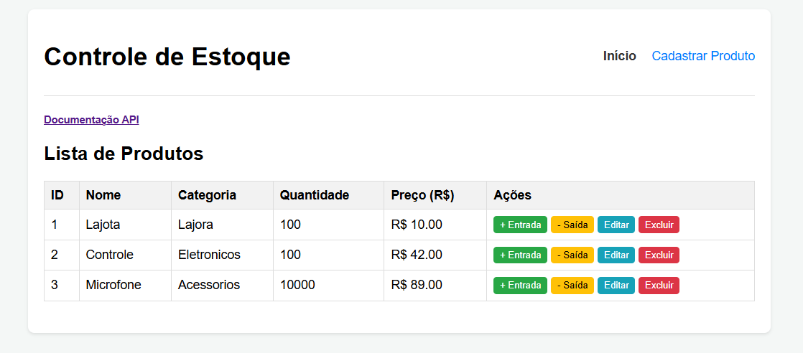
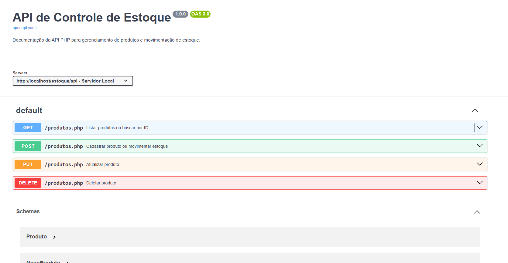

# 📦 Sistema de Controle de Estoque (API REST + Interface)


API RESTful desenvolvida em PHP puro com banco de dados SQLite para gerenciamento de produtos, controle de estoque (entradas e saídas) e documentação interativa via OpenAPI / Swagger UI.

---

## 📸 Demonstração

### Tela Principal do Sistema


### Documentação Interativa (Swagger UI)


---

## 🚀 Funcionalidades

- **CRUD Completo de Produtos:** Listagem geral ou por ID, cadastro, atualização de dados e exclusão.
- **Movimentação de Estoque:** Controle automatizado de entradas e saídas de itens sem permitir saldo negativo.
- **Banco de Dados Automático:** Criação automática do arquivo SQLite (`estoque.db`) e da tabela `produtos` na primeira execução.
- **Documentação Integrada:** Interface Swagger UI pronta para testar todas as rotas diretamente pelo navegador.

---

## 🛠️ Tecnologias Utilizadas

- **Back-end:** PHP (PDO)
- **Banco de Dados:** SQLite
- **Documentação:** OpenAPI 3.0 (`openapi.yaml`) e Swagger UI (`docs.html`)

---

## 📂 Estrutura de Pastas

```text
/seu-projeto/
│
├── api/
│   ├── produtos.php      # Endpoints da API (GET, POST, PUT, DELETE)
│   ├── conexao.php       # Conexão e criação automática do banco SQLite
│   ├── openapi.yaml      # Especificação OpenAPI 3.0
│   └── docs.html         # Interface visual do Swagger UI
│
├── banco/
│   └── estoque.db        # Gerado automaticamente na primeira requisição
│
├── assets/               # Imagens utilizadas neste README
└── index.html            # Página principal da aplicação
```

---

## ⚙️ Como Executar o Projeto

### Pré-requisitos
- Ter o **PHP** instalado na máquina (ou um ambiente como XAMPP, WAMP, Laragon).
- Extensão `pdo_sqlite` habilitada no PHP.

### Opção 1: Utilizando o XAMPP
1. Clone este repositorio para a pasta `htdocs` do XAMPP (geralmente localizada em `C:\xampp\htdocs\`).
2. Abra o **XAMPP Control Panel** e clique em **Start** no serviço do **Apache** *(não é necessário iniciar o MySQL, pois o projeto usa SQLite)*.
3. Abra o navegador e acesse:
   - **Página Principal:** `http://localhost/estoque/`
   - **Documentação da API:** `http://localhost/estoque/api/docs.html`

### Opção 2: Utilizando o Servidor Embutido do PHP (Terminal)

1. Clone este repositório:
   ```bash
   git clone https://github.com/Yukkie-bdb/API-Estoque-Essencial
   ```

2. Acesse a pasta do projeto pelo terminal:
   ```bash
   cd eestoque
   ```

3. Inicie o servidor embutido do PHP:
   ```bash
   php -S localhost:8000
   ```

4. Acesse no seu navegador:
   - **Aplicação Principal:** `http://localhost:8000`
   - **Documentação da API (Swagger):** `http://localhost:8000/api/docs.html`

---

## 📌 Endpoints Principais

| Método | Rota | Descrição |
| :--- | :--- | :--- |
| `GET` | `/api/produtos.php` | Lista todos os produtos cadastrados |
| `GET` | `/api/produtos.php?id={id}` | Busca um produto específico pelo ID |
| `POST` | `/api/produtos.php` | Cadastra um novo produto ou movimenta o estoque (`acao: "movimentar"`) |
| `PUT` | `/api/produtos.php` | Atualiza nome, categoria e preço de um produto |
| `DELETE` | `/api/produtos.php?id={id}` | Remove um produto do sistema |

---